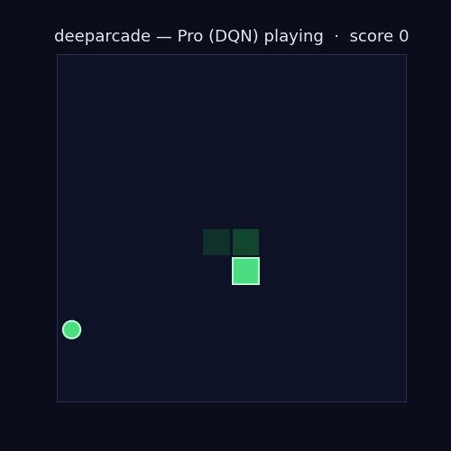
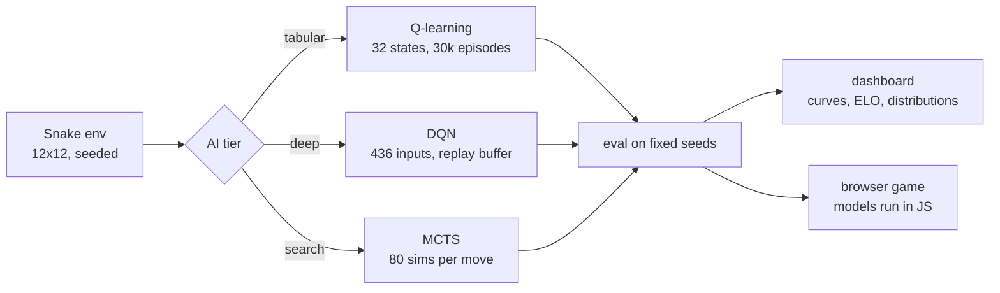

# deeparcade


Snake with opponents that actually learned to play. Three of them. A Q-learner, a deep Q-network, and an MCTS that thinks before every move. You can play them right in your browser.



**[Live interactive demo](https://faiyazenayet.github.io/deeparcade/docs/dashboard.html).** Learning curves, ELO history, score distributions, head-to-head stats. Every number on that page came from a real run.

**[Play the game](https://faiyazenayet.github.io/deeparcade/docs/game.html).** It runs the trained models directly in JavaScript. No server.

## Meet the opponents

**Rookie** is tabular Q-learning. It sees 32 states: danger ahead, left, right, plus where the food is. Three actions. It trained for 30,000 episodes in 19 seconds and learned to eat cleanly.

**Pro** is a deep Q-network. It sees the whole 12x12 board as pixels. Two hidden layers, experience replay, a target network. It trained for 300,000 steps. The learning curve climbs the whole way.

**Grandmaster** is MCTS. It never trained. Every move, it runs 80 simulated futures and picks the winner. It is by far the strongest player here.

Here is the honest surprise from evaluation. Rookie beats Pro. The 32-state abstraction is just that good, and learning from raw pixels is genuinely harder. The dashboard shows all of it.

## Measured results

500 seeded games per policy. MCTS played 50 (it thinks slowly). Fixed seeds, no cherry-picking.

| Policy | Mean | Std | Median | ELO |
|---|---|---|---|---|
| Random | 0.16 | 0.41 | 0.0 | 574 |
| Greedy heuristic | 19.89 | 6.64 | 19.0 | 1319 |
| Rookie (tabular Q) | 20.78 | 7.52 | 21.0 | 1369 |
| Pro (DQN) | 5.39 | 2.65 | 5.0 | 928 |
| Grandmaster (MCTS) | 44.1 | 11.29 | 44.5 | 1810 |

Training: Rookie went from 0.28 to 11.54 mean score per 100 episodes. Pro went from 0.54 to 4.54. Both curves are in the dashboard.

Move-level analysis: Greedy goes straight 79% of the time and eats 10.57 food per 100 steps. Grandmaster is more balanced (49% straight) at 7.73. Rookie sits at 8.51. Pro manages 4.08. Random flails at 0.72.

## How it works



The Python game logic and the browser game share the exact same state encoding. The Q-table is exported as JSON and plays identically in both. The DQN weights are exported too, and the network runs as a plain forward pass in JavaScript. Same trained brain, no backend.

## The game

Three modes. Classic is the open arena. Maze adds walls (Grandmaster territory, since the learners never saw walls). Blitz speeds up every time you eat.

Tournament mode ladders you up: Pro, then Rookie, then Grandmaster, in ELO order. Your rating updates after each match against the AI's measured score.

Every game records its seed and actions, so replays re-simulate perfectly. Pause, step, change speed. Leaderboards and your ELO live in your browser.

Juice included: particles, screen shake, floating score popups, smooth interpolated movement.

## Run it yourself

```bash
pip install -e ".[dev]"
python scripts/train.py --episodes 30000        # Rookie
python scripts/train_dqn.py --steps 300000       # Pro
python scripts/evaluate.py                       # all tiers, fixed seeds
python scripts/analyze.py                        # move-level stats
python scripts/make_dashboard.py                 # docs/dashboard.html
python scripts/make_gif.py                       # docs/demo.gif
python scripts/make_game.py                      # docs/game.html
pytest                                           # 23 tests
```

## Limitations

Scores are measured on 12x12 classic Snake with fixed seeds. Different seeds shift the numbers a bit. Rookie and Pro trained on classic only, so they play maze mode blind to walls. Pick Grandmaster there. MCTS strength scales with its simulation budget; the browser uses fewer sims to stay responsive. Human ELO is a rough estimate from single scores, not a real rating. The DQN trained on CPU in under nine minutes; a longer run would likely score higher.
