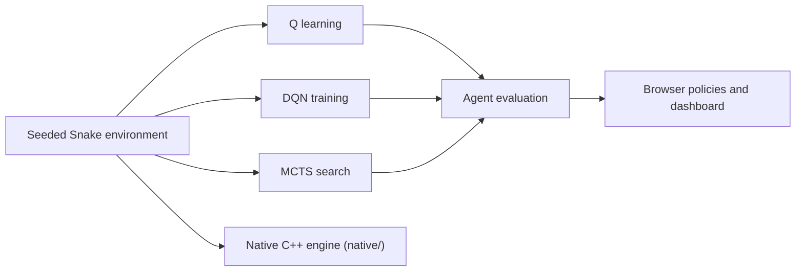

<p align="center"></p>

<h1 align="center">DeepArcade</h1>

<p align="center">
  <a href="https://github.com/FaiyazEnayet/deeparcade/actions/workflows/ci.yml"></a>
  <a href="https://github.com/FaiyazEnayet/deeparcade/actions/workflows/native.yml"></a>
  <a href="LICENSE"></a>
  
  
  
</p>

<p align="center">
  <a href="https://faiyazenayet.github.io/deeparcade/docs/game.html"></a>
  <a href="https://faiyazenayet.github.io/deeparcade/docs/dashboard.html"></a>
  <a href="#run-locally"></a>
</p>

DeepArcade compares random, heuristic, tabular Q-learning, DQN and MCTS Snake agents. The dashboard pairs evaluation results with the actual browser game, so the behavior can be inspected as well as summarized.

<p align="center"><a href="https://faiyazenayet.github.io/deeparcade/docs/dashboard.html"></a></p>

Pro uses a residual convolutional DQN trained on the Snake board as spatial channels, with heading supplied after pooling. The browser deploys the seed 9 export. Rookie uses tabular Q-learning, Grandmaster uses MCTS, and the frozen flat MLP remains selectable as Previous Pro.

The CNN comparison holds the MLP training protocol constant. Every run uses 300,000 environment steps, seeds 7, 8 and 9, identical reward shaping, Adam at 1e-3, gamma 0.95, batch 64, replay 50,000, updates every 8 steps, target sync every 2,000 steps, epsilon 1.0 to 0.05 over 120,000 steps, warmup 2,000, the same episode-key training partition, and CPU execution.

## Explore

- Compare every seed's held-out score and paired confidence intervals against the frozen MLP, Rookie and Greedy.
- Inspect the recorded learning curves and the inference-speed tradeoff.
- Play or watch Pro's residual CNN, the frozen MLP, tabular Q-learning or MCTS in the browser.

## Held-out comparison

`runs/da8_comparison.json` records 500 keyed test episodes per policy, paired by episode key. The test namespace is disjoint from the training partition by construction. These scores belong to a separate evaluation namespace from the legacy table below.

| Policy | Seed 7 | Seed 8 | Seed 9 |
| :--- | ---: | ---: | ---: |
| Retrained MLP control | 5.61 | 5.16 | 5.60 |
| Plain CNN | 12.16 | 13.19 | 12.97 |
| Residual CNN | 16.82 | 20.42 | 21.86 |

The frozen MLP scores 5.28, Rookie scores 20.78, and Greedy scores 20.61 in this keyed namespace. The plain encoder has 13,795 parameters and the residual encoder has 32,291.

| Paired difference against frozen MLP | Seed 7 | Seed 8 | Seed 9 |
| :--- | ---: | ---: | ---: |
| Plain CNN | +6.88 | +7.92 | +7.69 |
| Residual CNN | +11.54 | +15.14 | +16.58 |

Every 95% confidence interval above is far from zero. Against Rookie, the residual CNN trails by -3.96 (CI -4.83 to -3.09) for seed 7, ties at -0.36 (CI -1.34 to +0.62) for seed 8, and edges ahead at +1.08 (CI +0.07 to +2.09) for seed 9. Against Greedy, seed 9 is +1.25 (CI +0.22 to +2.27). The plain CNN trails Rookie and Greedy by about -7.4 to -8.6 paired.

Spatial structure is a large, real improvement over the flat MLP under matched conditions. The residual CNN reaches the tabular and heuristic baselines but does not clearly beat them. Residual seed variance is wide, from 16.82 to 21.86, so the browser's seed 9 policy is presented alongside all three trained seeds.

## Training and inference

| Final training mean-100 score | Seed 7 | Seed 8 | Seed 9 |
| :--- | ---: | ---: | ---: |
| MLP control | 4.24 | 4.90 | 4.36 |
| Plain CNN | 9.85 | 10.29 | 9.89 |
| Residual CNN | 11.59 | 11.61 | 13.64 |

Measured inference is approximately 21,600 decisions per second for the MLP, 2,000 for the plain CNN and 1,000 for the residual CNN. The residual model costs roughly 20 times as much decision time as the MLP. These are inference measurements from `runs/da8_comparison.json`; training curves and final scores are committed under `runs/` for each seed.

## Legacy evaluation

The archived legacy results below come from `runs/eval_legacy.json`. The non-MCTS policies have 500 episodes, while MCTS has 50. This namespace is separate from the keyed test comparison.

| Agent | Mean food score |
| :--- | ---: |
| Random | 0.16 |
| Greedy | 19.89 |
| Rookie, tabular Q-learning | 20.78 |
| Previous Pro, frozen MLP | 5.39 |
| Grandmaster, MCTS | 44.1 |

The current paired-pool record in `runs/eval.json` reports Grandmaster mean 46.14 and median 47.0 over 50 episodes. Keep this record separate from the archived 44.1 mean. ELO ratings and head-to-head results in that file belong to the evaluated policies and do not supply an ELO rating for the CNN. Tournament rounds against the CNN therefore compare scores without updating the player's ELO.

## Dashboard and game

The dashboard presents the matched comparison, uncertainty, recorded training trajectories and the independently labeled legacy records. The game embeds the residual CNN seed 9 weights and runs its forward pass locally. The frozen MLP remains available through the model selector. The README animation shows an actual residual CNN rollout rather than a dashboard tour.

## Run locally


```sh
python -m pip install -e ".[dev]"
python -m pip install -r portfolio_ui/requirements.txt
python -m pytest tests -q
python scripts/make_game.py
python scripts/make_dashboard.py
```

The native C++ engine builds and tests separately:

```sh
cmake -S native -B native/build -DCMAKE_BUILD_TYPE=Release
cmake --build native/build -j
ctest --test-dir native/build --output-on-failure
```

With the pybind11 extension built, `NARCADE_NATIVE=1` switches the Python package to the native backend.

Open [the standalone game](https://faiyazenayet.github.io/deeparcade/docs/game.html) to play without the dashboard.

## Technical design

The agent roster deliberately mixes simple baselines, learned policies and search. Tabular Q-learning and DQN learn policies; MCTS searches from the current state. Exported policy data lets the browser execute the learned behavior without a model server. The same game remains available within the dashboard and as a standalone file.



## Native C++ engine

DeepArcade includes a native C++20 engine under `native/` as an optional backend. It implements the Snake environment, a CPython-compatible RNG, the tabular policies and Q-learning agent, MCTS, the evaluation protocol, the training protocol, move-level trace instrumentation, DQN inference over the exported JSON weights, and a tournament runner that plays repeated round-robin rounds of paired episodes between all five players and computes Elo standings. Python remains the reference and the default; the native backend is enabled with `NARCADE_NATIVE=1` once the pybind11 extension is built.

Parity is enforced, not assumed. Golden fixtures generated from the Python reference (`native/golden/`, regenerable with `tools/native_reference.py`) pin the behavior, and the C++ runners replay frozen corpora against them: 111,032 Snake transitions, 36,129 policy states, 1,039 MCTS searches with bit-exact root values, 404 further MCTS searches on maze-mode wall layouts (the browser game's walled arena, 977 root children, also bit-exact), 200 evaluation episodes, the full 30,000-episode training protocol, and 13,824 DQN states with complete action agreement. Two boundaries are explicit: DQN training stays in Python (the native side is inference only), and the native evaluator covers the non-neural players, which its report states in a scope field. The `regen_check` CTest regenerates the fixtures from the Python reference and byte-compares them, and `meta_check` (`native/tests/meta_check.cmake`) verifies each golden file's SHA-256 against `native/golden/meta.json`.

A separate Native workflow in GitHub Actions builds the engine and runs the CTest suite on every push and pull request; `eval_fuzz` is excluded there for runtime and remains a local gate: changes to the native evaluation code require a documented local `eval_fuzz` run. A frozen subset of the evaluation protocol (seeds 5000 to 5002 for all four players, `native/golden/eval_regression.json`, regenerated with `tools/native_reference.py --eval-regression`) is replayed by the `eval_regression` CTest, so hosted CI still guards evaluation parity on every run.

Build and test:

```sh
cmake -S native -B native/build -DCMAKE_BUILD_TYPE=Release
cmake --build native/build -j
ctest --test-dir native/build --output-on-failure
```

The tournament runner plays round-robin rounds between all five players (the DQN player included, through the native inference module) with Elo carried across rounds, and writes a JSON standings report:

```sh
native/build/narcade_tournament --out runs/tournament.json
```

## Code and data

`src/narcade/` contains the Snake environment and agents. `native/` contains the C++ engine: environment, RNG, policies, MCTS, evaluator, trainer and DQN inference, with golden corpora under `native/golden/`. `runs/eval.json` stores the evaluation. `runs/artifact_manifest.json` pins the SHA-256 hash and production metadata (architecture, seed, steps, evaluation protocol) of the qtable, policy, DQN weights, evaluation and diagnosis artifacts, and `scripts/make_game.py` verifies the artifacts against it before injecting policy data. `runs/model_cards.json` collects one compact model card per evaluated agent: its kind (baseline, heuristic, learned or search), the training record, the checkpoint and export hashes cross-checked against the hashes the evaluator recorded, the evaluation figures and a measured inference cost per decision; `scripts/model_cards.py` builds and verifies the cards, and its smoke command trains tiny Q-learning and DQN models and rebuilds verifiable cards end to end. `web/game.html` is the browser template.


## Limitations

- Recorded evaluation uses the classic board; other browser modes are distribution shifts.
- Browser MCTS adapts its search budget, so browser scores are not the fixed evaluation protocol.
- Human ELO is a browser-local single-score estimate; it is separate from the recorded paired-policy evaluation. Tournament standings retain the Rookie → Pro → Grandmaster round sequence, with restart, free play and main-menu choices at completion.

## License

[MIT](LICENSE). Third-party datasets, libraries and fonts retain their own terms.
