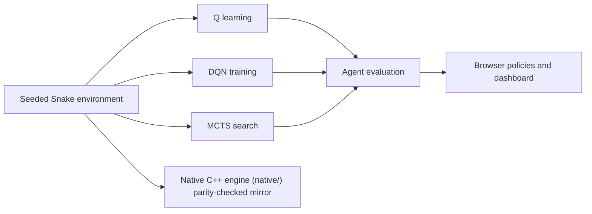
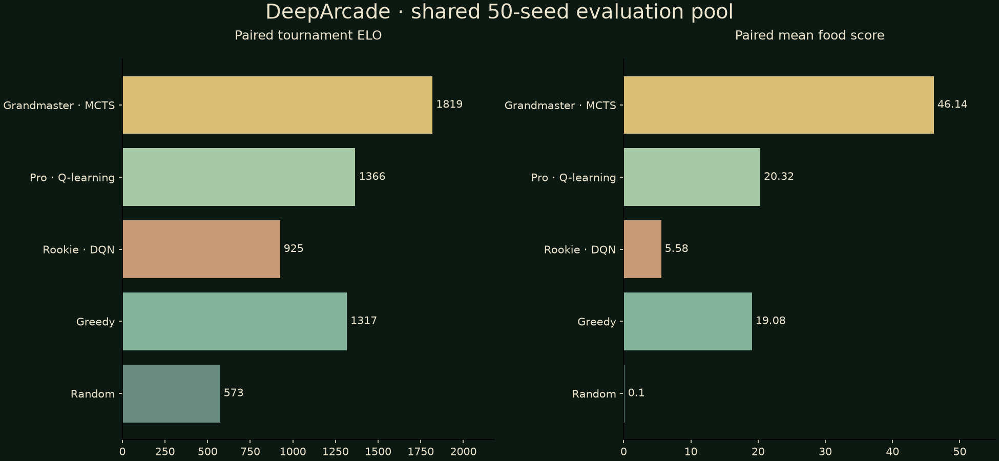

<p align="center"></p>

[](https://github.com/FaiyazEnayet/deeparcade/actions/workflows/ci.yml) [](LICENSE)    [](https://faiyazenayet.github.io/deeparcade/docs/dashboard.html)

<p align="center"><a href="https://faiyazenayet.github.io/deeparcade/docs/dashboard.html"><b>Open interactive demo</b></a> · <a href="#method">Method</a> · <a href="#run-locally">Run locally</a></p>

# DeepArcade

DeepArcade compares random, heuristic, tabular Q-learning, DQN and MCTS Snake agents. The dashboard pairs evaluation results with the actual browser game, so the behavior can be inspected as well as summarized. The Python implementation is mirrored by a native C++20 engine under `native/`, checked against the Python reference on frozen corpora; Python remains the reference and the default.


[](https://faiyazenayet.github.io/deeparcade/docs/dashboard.html)


Playing against the trained policies makes their evaluation easier to interpret. A strong average score can coexist with brittle turns, long loops or inconsistent behavior across seeds, which a single showcase run cannot establish. The agent comparison therefore keeps score distributions, training curves and evaluation sample counts alongside the playable experience.

## Explore

- Compare agent score distributions, learning behavior and head-to-head outcomes.
- Load the genuine game inside the dashboard or open the standalone HTML game.
- Use keyboard controls, then restart directly over the board after a run ends.

## Method

Agents are evaluated on seeded classic-board games. Learning curves, score distributions, pairwise outcomes and strategy statistics retain their original evaluation conditions. The browser game uses exported policies and a JavaScript forward pass.

## Evidence at a glance

| Scope | Recorded result or contract |
| :--- | :--- |
| Evaluation games | 500 per policy, except MCTS with 50 |
| Mean food score | Random 0.16; greedy 19.89; tabular Q 20.78 |
| Same evaluation | DQN 5.39; MCTS 44.1 |
| Native parity | 111,032 environment transitions, 36,129 policy states and 1,039 MCTS searches checked, plus 404 MCTS searches on maze-mode wall layouts; Q-learning and the full 30,000-episode training protocol bit-exact; 13,824 DQN states with complete action agreement (max logit difference under 1e-5) |
| Interpretation | MCTS has a smaller sample; the DQN does not outperform the simple baselines |

## Updating this project

Dashboard source language: **Python and browser JavaScript**. Generator: `scripts/make_dashboard.py and scripts/make_game.py`. The local interactive output is `docs/dashboard.html`.

## Run locally


```sh
python -m pip install -e ".[dev]"
python -m pip install -r portfolio_ui/requirements.txt
python -m pytest tests -q
python scripts/make_game.py
python scripts/make_dashboard.py
```

The native C++ engine builds and tests separately:

```sh
cmake -S native -B native/build -DCMAKE_BUILD_TYPE=Release
cmake --build native/build -j
ctest --test-dir native/build --output-on-failure
```

With the pybind11 extension built, `NARCADE_NATIVE=1` switches the Python package to the native backend.

Open [the standalone game](https://faiyazenayet.github.io/deeparcade/docs/game.html) to play without the dashboard.

## Technical design

The agent roster deliberately mixes simple baselines, learned policies and search. Tabular Q-learning and DQN learn policies; MCTS searches from the current state. Exported policy data lets the browser execute the learned behavior without a model server. The same game remains available within the dashboard and as a standalone file.



## Native C++ engine

The Python implementation is mirrored by a native C++ engine under `native/`: the Snake environment, a CPython-compatible RNG, the tabular policies and Q-learning agent, MCTS, the evaluation protocol, the training protocol, move-level trace instrumentation, and DQN inference over the exported JSON weights. Python remains the reference and the default; the native backend is optional (`NARCADE_NATIVE=1` with the pybind11 extension built).

Parity is enforced, not assumed. Golden fixtures generated from the Python reference (`native/golden/`, regenerable with `tools/native_reference.py`) pin the behavior, and the C++ runners replay frozen corpora against them: 111,032 Snake transitions, 36,129 policy states, 1,039 MCTS searches with bit-exact root values, 404 further MCTS searches on maze-mode wall layouts (the browser game's walled arena, 977 root children, also bit-exact), 200 evaluation episodes, the full 30,000-episode training protocol, and 13,824 DQN states with complete action agreement. Two boundaries are explicit: DQN training stays in Python (the native side is inference only), and the native evaluator covers the non-neural players, which its report states in a scope field. The `regen_check` CTest regenerates the fixtures from the Python reference and byte-compares them, and `meta_check` (`native/tests/meta_check.cmake`) verifies each golden file's SHA-256 against `native/golden/meta.json`. A separate Native workflow in GitHub Actions builds the engine and runs the CTest suite on every push and pull request; `eval_fuzz` is excluded there for runtime and remains a local gate.

Build and test:

```sh
cmake -S native -B build/native -DCMAKE_BUILD_TYPE=Release
cmake --build build/native -j4
ctest --test-dir build/native
```

## Evaluation protocol

Recorded evaluation uses seeded classic-board games, with 500 games for most policies and 50 for MCTS. Scores, distributions, learning curves and pairwise outcomes answer different questions. Browser maze/blitz modes and adaptive MCTS budgets are not equivalent to the fixed recorded evaluation.



The DQN underperforms the greedy and tabular baselines in the committed run. The MCTS mean is high but comes from a smaller sample. A convincing comparison requires the stated game conditions, seeds and sample counts rather than agent names or apparent sophistication.

## Code and data

`src/narcade/` contains the Snake environment and agents. `native/` contains the C++ engine: environment, RNG, policies, MCTS, evaluator, trainer and DQN inference, with golden corpora under `native/golden/`. `runs/eval.json` stores the evaluation. `web/game.html` is the browser template; `scripts/make_game.py` injects policy data.


## Limitations

- Recorded evaluation uses the classic board; other browser modes are distribution shifts.
- Browser MCTS adapts its search budget, so browser scores are not the fixed evaluation protocol.
- Tournament state handling needs a correction before its ELO changes are treated as reliable. Replay UI and direction buttons were intentionally removed from this edition.

## License

[MIT](LICENSE). Third-party datasets, libraries and fonts retain their own terms.
